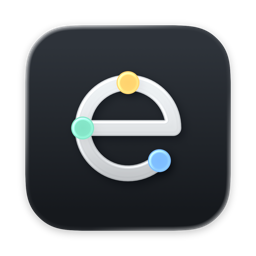

  

  <picture>
    <source media="(prefers-color-scheme: dark)" srcset="images/euno-ja-dark.gif">
    
  </picture>

# euno

[English](README.en.md)

euno は、Claude、Codex、Cursor のチャットをブリッジで結び、AI が相手のチャットの会話を必要なときに読めるようにする macOS のメニューバーアプリです。

このリポジトリでは、euno の配布と不具合報告の受け付けを行います。ソースコードは公開していません。

euno は Anthropic、OpenAI、Anysphere とは関係のない、個人が開発した非公式のアプリです。

## 必要なもの

- macOS 15（Sequoia）以降
- Apple シリコン搭載の Mac
- 次のアプリのうち2つ以上
  - Claude（デスクトップアプリの Code モード、または Claude Code）
  - Codex
  - Cursor
- MCP サーバーの登録には、Claude と Codex では各アプリの CLI（`claude`、`codex`）を使います。スキルの導入には `npx`（Node）を使います。

## インストール

1. [euno.dmg をダウンロード](https://github.com/fenrirxdev/euno/releases/latest/download/euno.dmg)します。
2. DMG を開き、euno を「アプリケーション」フォルダにドラッグします。
3. 「アプリケーション」フォルダから euno を開きます。

DMG の中から開いた euno では、MCP サーバーを登録できません。必ず「アプリケーション」フォルダに移してから開いてください。

## 初めて使うとき

1. **アクセシビリティを許可する**：euno は、各アプリで表示中のチャットを見分けるためと、右 ⌘ キーの2回押しを受け取るために、アクセシビリティの許可を使います。押されたキーの内容は読み取らず、記録もしません。
2. **アプリを登録する**：euno の設定の「連携」で、使うアプリごとに MCP サーバーとスキルを登録します。登録より前に始めたチャットでは使えません。登録のあとは新しいチャットを始めてください。Codex はアプリの再起動も必要です。
3. **ブリッジを作る**：右 ⌘ キーを2回押してパネルを開き、結びたいチャットを選びます。

チャットの中では、Claude と Cursor では `/euno`、Codex では `$euno` で相手のチャットを読み込めます。

## アップデート

euno は新しいバージョンを自動で確認できます。自動で確認するかどうかは2回目に起動したときに尋ねます。あとから設定で変えられます。手動で確認するときは、設定の「一般」にある「アップデートを確認」を使います。

## プライバシー

- euno は、各アプリが Mac の中に保存しているチャットの履歴を読み取り専用で読みます。履歴を書き換えることはありません。
- 読み取るのは、あなたがブリッジで結んだチャットだけです。
- ブリッジの設定と、どの AI がどのチャットを読んだかの記録は、`~/Library/Application Support/euno` に保存します。
- アップデートの確認・ダウンロードやスキルの追加・更新で通信します。会話の本文、読んだ記録、利用状況を euno が外部へ送ることはありません。

読むもの、書くもの、送るものの一覧は [プライバシー](PRIVACY.md) にあります。ブリッジ名を AI に考えさせる操作では、チャットのタイトルとリポジトリの名前を選んだ CLI に渡します。

## アンインストール

1. euno の設定の「連携」で、各アプリの MCP サーバーの登録を解除し、スキルをアンインストールします。Cursor は `~/.cursor/mcp.json` から `euno` の項目を削除します。
2. euno を終了し、「アプリケーション」フォルダから削除します。
3. 設定と記録も消す場合は、`~/Library/Application Support/euno` を削除します。

## 不具合の報告

[Issues](https://github.com/fenrirxdev/euno/issues/new/choose) から報告してください。Issue は公開されます。会話の内容、個人名、トークンなどを書かないでください。

euno のメニューにある「問題を報告…」を使うと、バージョン、権限、連携の状態が入力された Issue の画面が開きます。会話の本文は含まれません。送信前に内容を確認してください。

## 対応状況

各アプリは、チャット履歴の保存形式を予告なく変えることがあります。その場合、euno が会話を読めなくなることがあります。現在はベータです。各リリースの変更点と制限はリリースノートに記載します。

## ライセンス

Copyright © 2026 fenrirxdev. All rights reserved.
